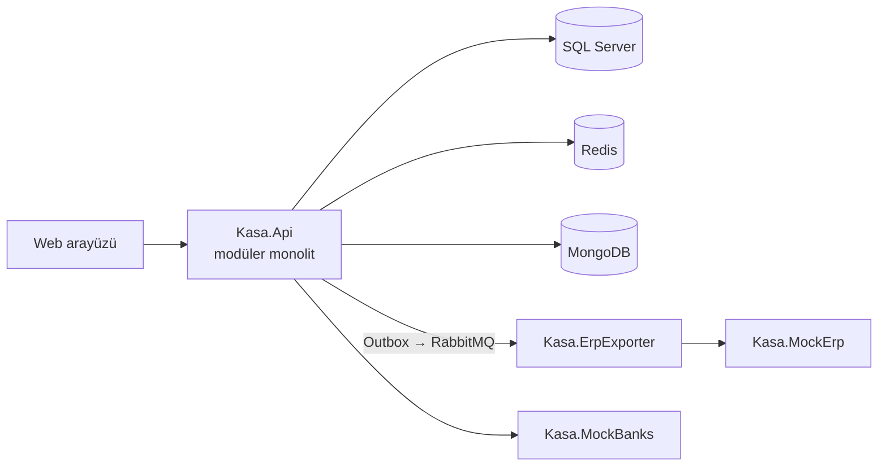

# Kasa

Şirketler için nakit yönetimi: bütün banka hesapları tek ekranda, hareketler otomatik olarak doğru cari hesapla
eşleşiyor, muhasebe programına (Logo Tiger benzeri bir test ERP'si) aktarılıyor ve sorular bir yapay zekâ asistanına
sorulabiliyor.

> Bu bir pratik projesi. Bankalar ve ERP test için kurgulandı, bütün veriler örnek veridir.

**Durum:** Sprint 0 tamamlandı (iskelet, altyapı, CI). Plan ve sprintler: [docs/PLAN.md](docs/PLAN.md)

## Mimari



Neden böyle: [docs/kararlar/0001](docs/kararlar/0001-moduler-monolit-ve-tek-mikroservis.md)

| Proje | Ne | Adres |
|---|---|---|
| `src/Kasa.Api` | Ana uygulama | http://localhost:5100 |
| `src/Kasa.ErpExporter` | ERP aktarım servisi | http://localhost:5101 |
| `src/Kasa.MockBanks` | Test bankaları (REST ve SOAP) | http://localhost:5102 |
| `src/Kasa.MockErp` | Test ERP'si | http://localhost:5103 |
| `tests/Kasa.IntegrationTests` | Entegrasyon testleri | |

## Çalıştırma

Gerekenler: .NET 10 SDK ve Docker.

```bash
cp .env.example .env
docker compose up -d --wait        # SQL Server, Redis, MongoDB, RabbitMQ
dotnet run --project src/Kasa.Api  # her servis için ayrı bir terminalde
dotnet test
```

| Altyapı | Adres |
|---|---|
| SQL Server | `localhost,14335` |
| Redis | `localhost:6379` |
| MongoDB | `localhost:27017` |
| RabbitMQ | `localhost:5672`, yönetim paneli http://localhost:15672 |

Bellek sınırları 8 GB RAM'li bir dizüstüne göre ayarlı; dört servis toplam yaklaşık 4 GB ile sınırlı.

## Kararlar

Her teknoloji seçiminin gerekçesi `docs/kararlar/` altında: bağlam, seçenekler, karar ve sonuçları.

- [0001: Modüler monolit, ERP aktarımı için tek mikroservis](docs/kararlar/0001-moduler-monolit-ve-tek-mikroservis.md)
- [0002: .NET 10 (LTS) ve tek yerden sabitlenen paket sürümleri](docs/kararlar/0002-dotnet-10-ve-sabit-surumler.md)
