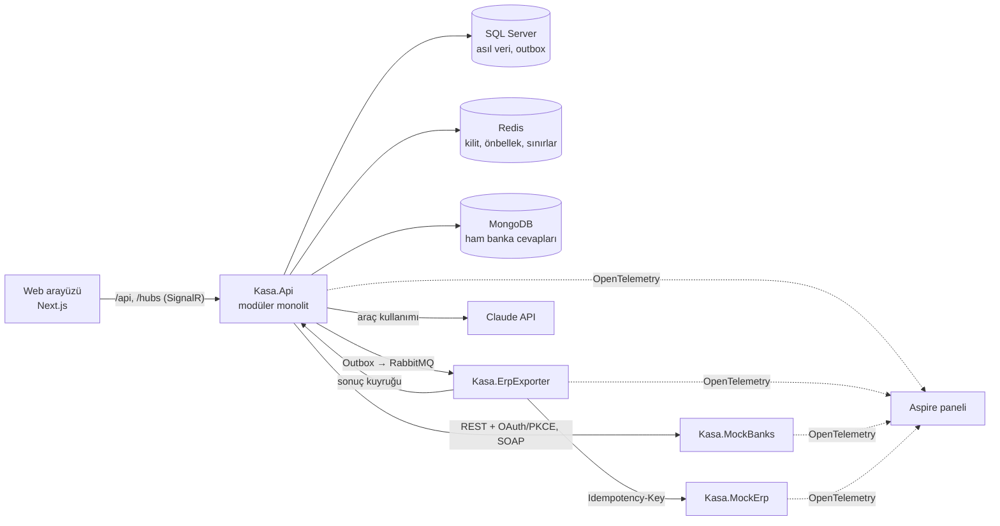

# Kasa

Şirketler için nakit yönetimi: bütün banka hesapları tek ekranda, hareketler otomatik olarak doğru cari hesapla
eşleşiyor, muhasebe programına (Türkiye'de yaygın ERP'lere benzeyen bir test ERP'si) aktarılıyor ve sorular bir yapay zekâ asistanına
sorulabiliyor.

> Bu bir pratik projesi. Bankalar ve ERP test için kurgulandı, bütün veriler örnek veridir.

**Durum:** Sprint 6 tamamlandı: iki banka, eşleştirme, RabbitMQ ile ERP aktarımı, web arayüzü, canlı panel, yapay zekâ asistanı, uçtan uca izleme; 18 hata senaryosu testli, 500 bin hareketle ölçüldü. Plan ve sprintler: [docs/PLAN.md](docs/PLAN.md)

## Mimari



Neden böyle: [docs/kararlar/0001](docs/kararlar/0001-moduler-monolit-ve-tek-mikroservis.md)

| Proje | Ne | Adres |
|---|---|---|
| `src/Kasa.Api` | Ana uygulama | http://localhost:5100 |
| `src/Kasa.ErpExporter` | ERP aktarım servisi | http://localhost:5101 |
| `src/Kasa.MockBanks` | Test bankaları (REST ve SOAP) | http://localhost:5102 |
| `src/Kasa.MockErp` | Test ERP'si (fişler http://localhost:5103 sayfasında) | http://localhost:5103 |
| `src/Kasa.Contracts` | API ile aktarım servisi arasındaki mesajlar ve kuyruklar | |
| `src/Kasa.ServiceDefaults` | Bütün servislerin ortak izleme ve sağlık ayarları | |
| `web` | Web arayüzü (Next.js) | http://localhost:3000 |
| `tests/Kasa.IntegrationTests` | Entegrasyon testleri | |

## Çalıştırma

Gerekenler: .NET 10 SDK ve Docker.

```bash
cp .env.example .env
docker compose up -d --wait        # SQL Server, Redis, MongoDB, RabbitMQ, izleme paneli
dotnet run --project src/Kasa.Api  # her servis için ayrı bir terminalde (Api, MockBanks, MockErp, ErpExporter)
cd web && npm ci && npm run dev    # http://localhost:3000
dotnet test
```

| Altyapı | Adres |
|---|---|
| SQL Server | `localhost,14335` |
| Redis | `localhost:6379` |
| MongoDB | `localhost:27017` |
| RabbitMQ | `localhost:5672`, yönetim paneli http://localhost:15672 |
| İzleme (Aspire paneli) | http://localhost:18888 |

Bankaları denemek için `src/Kasa.MockBanks` ve `src/Kasa.Api` çalışırken Swagger'dan (http://localhost:5100/swagger) kayıt olun,
sonra `POST /api/bank-connections/klasikbank` ile bağlanın (kullanıcı `kasa`, şifre `klasik-dev-pass`; test bankasının
sabit değerleri). ERP için önce `PUT /api/company/erp` (`{"firmCode":"001"}`), sonra `POST /api/current-accounts/import`;
eşleşen hareketler birkaç saniye içinde http://localhost:5103 sayfasında fiş olarak görünür. Açık bankacılık için `POST /api/bank-connections/acikbank` dönen adresi tarayıcıda açın.

Asistanı açmak için Anthropic API anahtarını kendi makinenizde user-secrets'a koyun (depoya hiçbir zaman girmez):

```bash
dotnet user-secrets set "Assistant:ApiKey" "<anahtarınız>" --project src/Kasa.Api
```

Bellek sınırları 8 GB RAM'li bir dizüstüne göre ayarlı; dört servis toplam yaklaşık 4 GB ile sınırlı.

## Kararlar

Her teknoloji seçiminin gerekçesi `docs/kararlar/` altında: bağlam, seçenekler, karar ve sonuçları.

- [0001: Modüler monolit, ERP aktarımı için tek mikroservis](docs/kararlar/0001-moduler-monolit-ve-tek-mikroservis.md)
- [0002: .NET 10 (LTS) ve tek yerden sabitlenen paket sürümleri](docs/kararlar/0002-dotnet-10-ve-sabit-surumler.md)
- [0003: Kimlik: Identity, kısa ömürlü JWT, rotasyonlu yenileme anahtarı](docs/kararlar/0003-kimlik-jwt-ve-yenileme-anahtari.md)
- [0004: Şirket izolasyonu: sorgu filtresi ve yazma koruması](docs/kararlar/0004-sirket-izolasyonu.md)
- [0005: Redis bir hızlandırıcı, zorunluluk değil](docs/kararlar/0005-redis-bir-hizlandirici.md)
- [0006: Banka bağlantısı: açık bankacılık akışı ve sırların saklanması](docs/kararlar/0006-banka-baglantisi-ve-sirlar.md)
- [0007: Banka senkronu: tek kayıt garantisi, kilit, zamanlama ve hatalar](docs/kararlar/0007-senkron-tek-kayit-ve-hatalar.md)
- [0008: Ham banka cevaplarının MongoDB'de arşivlenmesi](docs/kararlar/0008-ham-cevap-arsivi-mongodb.md)
- [0009: ERP aktarımı: outbox, RabbitMQ ve idempotent tüketici](docs/kararlar/0009-outbox-rabbitmq-ve-idempotent-aktarim.md)
- [0010: Cari eşleştirme kuralları ve iyimser eşzamanlılık](docs/kararlar/0010-eslestirme-kurallari-ve-eszamanlilik.md)
- [0011: Web arayüzü: oturum, API'ye geçiş ve canlı güncelleme](docs/kararlar/0011-web-arayuzu-oturum-ve-canli-guncelleme.md)
- [0012: Panel önbelleği: sürüm anahtarıyla Redis](docs/kararlar/0012-panel-onbellegi.md)
- [0013: Yapay zekâ asistanı: sadece okuyan araçlar ve dar bir güven sınırı](docs/kararlar/0013-yapay-zeka-asistani.md)
- [0014: İzleme: Serilog yerine OpenTelemetry ve Aspire paneli](docs/kararlar/0014-izleme-opentelemetry.md)

## Kanıtlar

- [Hata senaryoları](docs/hata-senaryolari.md): "bu servis çökerse ne olur?" sorusunun 18 cevabı ve her birinin testi
- [Ölçümler](docs/olcumler.md): 500 bin hareketle liste, sayfalama ve panel süreleri
- [Güvenlik turu](docs/guvenlik.md): OWASP Top 10 (2025), yapılanlar ve bilerek eksik bırakılanlar
- [Yapay zekâ ile geliştirme](docs/ai-assisted-development.md): bu proje nasıl yapıldı

Sprint sonu soruları ve cevap ipuçları: [docs/sorular.md](docs/sorular.md). İş takibi: [GitHub Projects panosu](https://github.com/users/surakaraali/projects/1).
