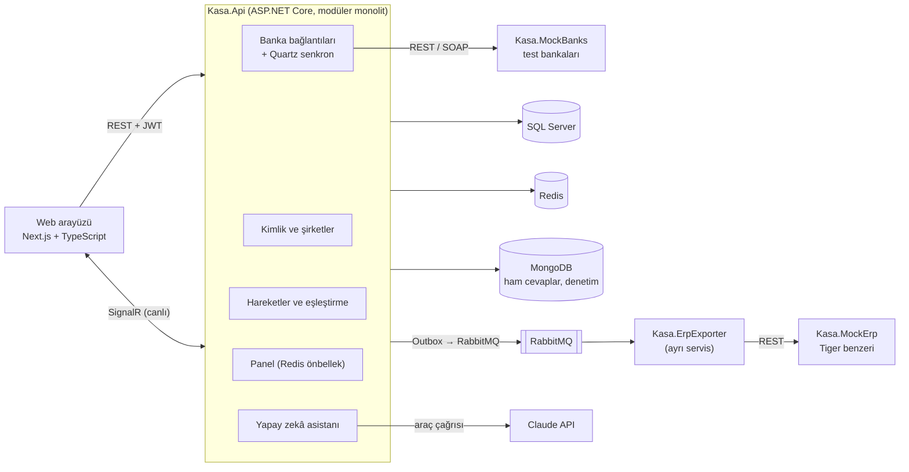

# Kasa: proje planı

> Çalışma adı **Kasa**. Şirketler için nakit yönetimi: bütün banka hesapları tek ekranda, hareketler otomatik
> eşleşiyor, muhasebe programına aktarılıyor, sorular bir yapay zekâ asistanına sorulabiliyor.
> Bu belge projeye başlamadan önce onay için yazıldı. Onaydan sonra her sprintin sonunda güncellenir.

---

## 1. Amaç ve başarı ölçütü

**Amaç:** Teknik mülakatta canlı gösterilecek, ilandaki her maddeyi gerekçesiyle kullanan, uçtan uca çalışan bir sistem.

Proje ancak şu altı koşul sağlanırsa **bitti** sayılır:

1. Tek komutla (`docker compose up` + iki `dotnet run` + `npm run dev`) bütün sistem ayağa kalkıyor.
2. Aşağıdaki **demo senaryosu** (bölüm 8) baştan sona hatasız çalışıyor.
3. **Hata senaryoları tablosundaki** (bölüm 9) her satır denendi, sonucu yazıldı, testi var.
4. Bütün testler ve CI yeşil.
5. Her teknoloji için "neden bunu seçtim, alternatifi neydi" notu var (`docs/kararlar/`).
6. **Sen** her sprintin sonunda o sprinti kendi cümlelerinle anlatabiliyorsun. Bunu mini soru-cevapla kontrol ediyoruz.

---

## 2. Ürün: kim, ne yapıyor

| Rol | Ne yapabilir |
|---|---|
| **Yönetici** | Şirketi kaydeder, kullanıcı davet eder, banka bağlar |
| **Muhasebeci** | Hareketleri görür, eşleşmeyenleri elle eşler, ERP'ye aktarır, asistana soru sorar |
| **İzleyici** | Sadece görür (panel, hareketler, asistan); hiçbir şeyi değiştiremez |

Her şirket yalnızca kendi verisini görür (çok kiracılı yapı).

---

## 3. Kapsam

**Olmazsa olmaz (çekirdek):**
- Kayıt, giriş, roller, kullanıcı daveti
- İki test bankası bağlama: biri açık bankacılık (REST, rıza akışı), biri eski usul (SOAP)
- Hareketlerin otomatik çekilmesi, tek kayıt, cari eşleştirme, elle eşleme
- Eşleşen hareketlerin ayrı bir servisle ERP'ye (Tiger benzeri test ERP) aktarılması
- Canlı panel: grafikler, yeni hareketin ekrana anında düşmesi
- Yapay zekâ asistanı (sadece okuma)
- Testler, CI, loglama, sağlık kontrolleri, dokümantasyon

**Vakit kalırsa:**
- Ödeme emri: açık bankacılık projesindeki akışın taşınması
- .NET Aspire ile tek tuşla çalıştırma ve izleme paneli
- Ücretli küçük bir sunucuya yayına alma

**Kapsam dışı (bilerek):** gerçek banka bağlantısı, gerçek para, e-posta gönderimi, mobil uygulama.

---

## 4. Mimari

**Neden modüler monolit + tek mikroservis?** Her şeyi mikroservise bölmek küçük bir ekip için gereksiz karmaşa demek.
Ana uygulama tek parça kalıyor, içi modüllere ayrılıyor. Sadece **ERP aktarımı** ayrı bir servis, çünkü onun gerçekten ayrı
olması için sebepler var: ERP yavaş ve sık çöküyor, aktarım ana uygulamayı bekletmemeli, ERP kapalıyken iş birikip sonra
devam etmeli. Mülakatta "neden her şey mikroservis değil?" sorusunun cevabı bu.

### Projeler

| Proje | Ne | Port |
|---|---|---|
| `Kasa.Api` | Ana uygulama: Web API, SignalR hub, Quartz işleri, asistan | 5100 |
| `Kasa.ErpExporter` | RabbitMQ'dan okur, ERP'ye fiş yazar (Worker Service) | 5101 (sadece sağlık kontrolü) |
| `Kasa.MockBanks` | REST açık bankacılık bankası + SOAP eski banka | 5102 |
| `Kasa.MockErp` | Tiger benzeri cari ve fiş API'si; yavaşlık ve hata simülasyonu var | 5103 |
| `Kasa.Contracts` | Servisler arası mesaj sözleşmeleri | |
| `web` | Next.js arayüz | 3000 |
| `tests/*` | Birim, entegrasyon ve uçtan uca testler | |

Docker'da: SQL Server (14335), Redis (6379), MongoDB (27017), RabbitMQ (5672, yönetim paneli 15672).

---

## 5. Teknoloji kararları (mülakattaki "neden?" sorularının cevapları)

Her satır `docs/kararlar/` altında ayrı bir karar notu olacak: bağlam, seçenekler, karar, sonuçları.

| Konu | Seçim | Neden | Alternatif ve neden değil |
|---|---|---|---|
| Çatı | **.NET 10 (LTS)** | Uzun destekli sürüm; .NET 11 kısa destekli (STS) | .NET 11: yeni, ama destek süresi kısa |
| Veri erişimi | **EF Core 10** + gerektiğinde ham SQL | Göç (migration), sorgu filtresi ile şirket izolasyonu | Dapper: yalnızca ölçülmüş yavaş sorgularda |
| Ana veritabanı | **SQL Server** | İlanda isteniyor; para kaydı için ilişkisel tutarlılık ve benzersizlik kuralları | |
| Kimlik | **ASP.NET Core Identity** + kendi JWT'miz + yenileme anahtarı rotasyonu | Şifre saklama ve kilitlemeyi Identity yapıyor; token süresi ve rotasyonu bizim kontrolümüzde | Hazır `MapIdentityApi`: JWT değil, rotasyon yok |
| Zamanlanmış iş | **Quartz.NET** | Kalıcı zamanlama, aynı işin aynı anda iki kez çalışmaması | `BackgroundService` + Timer: kalıcı değil |
| Önbellek ve kilit | **Redis** | Panel toplamları önbellekte (ölçülmüş fark), hesap başına senkron kilidi, giriş denemesi sınırı | Bellek içi önbellek: birden fazla sunucuda tutarsız |
| Gerçek zamanlı | **SignalR** (Redis backplane'e hazır) | Yeni hareket ve aktarım durumu ekrana anında düşer | Sürekli sorgulama (polling): gereksiz yük |
| Mesajlaşma | **RabbitMQ** (`RabbitMQ.Client`) + **Outbox deseni** | Veritabanı kaydı ile mesaj gönderimi tek işlemde; mesaj kaybolmaz | MassTransit: yeni sürümleri ticari lisanslı |
| NoSQL | **MongoDB** | Bankaların ham cevapları (her bankada farklı şema) ve denetim kayıtları | SQL'de JSON sütunu: mümkün, ama sorgulama ve şema esnekliği zayıf |
| Yapay zekâ | **Claude** (resmî `Anthropic` C# SDK) + sadece okuma araçları | Araç çağrısı, akışlı (streaming) cevap | Modele veritabanı erişimi vermek: güvenlik riski |
| Test | **xUnit** + gerçek SQL Server + `WebApplicationFactory` | Benzersizlik kuralları ve göçler gerçek veritabanında test edilir | EF InMemory: kuralları uygulamıyor |
| Loglama | **Serilog** + **OpenTelemetry** izleri | Bir isteğin API → RabbitMQ → ERP yolculuğu tek izde görülür | |
| Arayüz | **Next.js** + **Recharts** + `@microsoft/signalr` | Zaten bildiğin teknoloji; zaman arka uca kalır | Blazor: yeni bir şey öğrenmek gerekir |

Paket sürümleri Sprint 0'da sabitlenir. Microsoft paketleri .NET 10 ile uyumlu 10.0.x sürümleri olacak. Kontrol
ettiğim güncel sürümler: `Anthropic` 13.10, `Quartz` 4.7, `StackExchange.Redis` 3.4, `MongoDB.Driver` 3.14,
`RabbitMQ.Client` 7.2, `next` 16.4, `@microsoft/signalr` 11.0, `recharts` 3.11. Hepsi kurulumda yeniden doğrulanır.

---

## 6. Veri modeli (taslak)

**SQL Server:**
- `Company`
- `User` (Identity) ve `CompanyUser` (rol)
- `RefreshToken`
- `BankConnection` (banka, rıza, şifreli token'lar)
- `BankAccount`
- `BankTransaction`: `(BankAccountId, BankReference)` benzersiz
- `CurrentAccount` (cari kartı: IBAN, vergi no)
- `MatchDecision` (otomatik mi elle mi, kim, ne zaman)
- `ErpExport` (hareket başına en fazla bir geçerli fiş)
- `OutboxMessage`

Her tabloda `CompanyId` var. EF Core sorgu filtresi her sorguya şirket şartını kendiliğinden ekliyor. Böylece bir
geliştirici şartı yazmayı unutsa bile başka şirketin verisi görünmüyor. Bunu bir test kanıtlıyor.

**MongoDB:**
- `bank_raw_responses`: her banka çağrısının ham cevabı, 30 gün sonra kendiliğinden siliniyor (TTL index)
- `audit_events`: kim, ne zaman, neyi değiştirdi

**Redis:**
- `dash:{companyId}:{period}`: panel toplamları. Yeni hareket gelince siliniyor.
- `lock:sync:{accountId}`: aynı hesabı iki sunucu aynı anda çekmesin diye kilit
- `ratelimit:login:{ip}`: giriş denemesi sınırı

---

## 7. Sprintler

Her sprint şu adımlarla kapanır:
1. Testler yeşil.
2. CI yeşil.
3. O sprintin demo adımı çalışıyor.
4. Karar notları yazıldı.
5. **Sen anlatıyorsun:** sana 5–8 soru soruyorum, cevaplayamadığın yeri birlikte netleştiriyoruz.
6. Commit atılıyor ve GitHub'a gönderiliyor (senin onayınla).

### Sprint 0: Hazırlık (yarım gün) ✅ 2026-11-19
- [x] Bilgisayarda yer açmak: eski projelerin 4 konteyneri durduruldu (silinmedi, verileri duruyor); yeniden indirilebilen imajlar ve derleme önbelleği silindi (~3 GB). Veri birimlerine ve StudyFlow'un Supabase imajlarına dokunulmadı.
- [x] Repo, `global.json` (.NET 10), çözüm dosyası, 4 servis, ortak ayarlar (uyarılar hata sayılır, nullable açık, merkezi paket yönetimi)
- [x] `docker-compose.yml`: SQL Server, Redis, MongoDB, RabbitMQ; bellek sınırları toplam ~4 GB (çalışırken ~1 GB kullanıyor)
- [x] CI (GitHub Actions): biçim kontrolü, build, test, compose dosyası doğrulaması
- [x] `docs/kararlar/` şablonu ve ilk iki karar notu, README
- Bilerek ertelenenler: `Kasa.Contracts` (Sprint 3'te ilk mesajla), birim test projesi (Sprint 1'de ilk mantıkla). Boş proje açmadık.
- **Çıktı:** dört servis `/health` cevabı veriyor, 4 test geçiyor, dört altyapı servisi sağlıklı

### Sprint 1: Kimlik ve şirketler ✅ 2026-11-19
- [x] Kayıt: şirket ve ilk yönetici tek işlemde oluşur; şifre zayıfsa şirket de geri alınır
- [x] Giriş: JWT (15 dk) ve yenileme anahtarı (httpOnly çerez, tek kullanımlık, rotasyonlu, çalınma tespiti)
- [x] Roller ve yetki politikaları; davet bağlantısıyla katılma (tek kullanımlık, 7 gün)
- [x] Şirket izolasyonu: EF Core sorgu filtresi ve `SaveChanges` koruması, testleriyle
- [x] Giriş denemesi sınırı (Redis), şifre kuralları, hesap kilitleme; Redis kapalıyken giriş çalışıyor
- [x] Testler: 22 entegrasyon testi (gerçek SQL Server ve Redis)
- Karar notları: 0003 kimlik, 0004 şirket izolasyonu, 0005 Redis bir hızlandırıcı
- **Çıktı:** API üzerinden kayıt, giriş, davet; Swagger'da denenebilir (http://localhost:5100/swagger)

### Sprint 2: Banka entegrasyonu ✅ 2026-11-19
- [x] `Kasa.MockBanks`: REST açık bankacılık (rıza, onay sayfası, OAuth 2.0 + PKCE, rotasyonlu yenileme anahtarı) ve SOAP banka (Türkçe tutar ve tarih biçimi); `/mock` ile hata, yavaşlık, bozuk veri ve canlı hareket
- [x] Banka bağlama akışı: rıza, banka sayfası, geri dönüş; state çerezle akışı başlatan tarayıcıya bağlı; sırlar Data Protection ile şifreli
- [x] Quartz ile 15 dakikada bir senkron (Türkiye saati); elle "şimdi çek"
- [x] Tek kayıt garantisi: `(hesap, banka referansı)` benzersiz (BIN2); Redis kapalıyken altı eşzamanlı senkron testi
- [x] Redis kilidi: aynı bağlantı aynı anda iki kez çekilmez (409 "zaten çekiliyor")
- [x] Ham cevaplar MongoDB'ye (TTL 90 gün; anahtar çağrıları, başlıklar ve şifre yazılmıyor); MongoDB kapalıyken senkron çalışıyor
- [x] Hata yönetimi: ulaşılamıyor / reddedildi / bozuk veri, her birinin sonucu tanımlı ve testli; 401'de anahtar yenilenip tekrar deneniyor
- [x] Hareketler listesi API'si: filtre, arama, keyset sayfalama
- [x] Testler: 22 yeni entegrasyon testi, toplam 44
- Karar notları: 0006 banka bağlantısı ve sırlar, 0007 senkron, 0008 ham cevap arşivi
- **Çıktı:** iki banka bağlı, hareketler akıyor

### Sprint 3: Eşleştirme ve ERP aktarımı ✅ 2026-11-19
- [x] `Kasa.MockErp`: Tiger tarzı cari kartlar, `Idempotency-Key` ile tahsilat/tediye fişi, hata modları, fişleri gösteren sayfa
- [x] Cari eşleştirme kuralları: IBAN, sonra vergi numarası; çakışma ya da çift aday kişiye bırakılır (birim testli)
- [x] Elle eşleme API'si: `rowversion` ile iyimser eşzamanlılık (409), "ERP'ye aktarılmayacak" kararı, denetim kaydı (SQL)
- [x] Outbox: eşleşme, denetim kaydı ve "aktar" mesajı aynı veritabanı işleminde; `UPDLOCK, READPAST` ile yayıncı
- [x] `Kasa.Contracts`: mesajlar ve RabbitMQ topolojisi (quorum kuyruklar, publisher confirms, mandatory)
- [x] `Kasa.ErpExporter`: RabbitMQ'dan okur, `Kasa.MockErp`'ye fiş yazar, sonucu `erp.results` ile döner
- [x] İdempotent tüketici: aynı mesaj iki kez gelirse tek fiş oluşur (testli)
- [x] Yeniden deneme (TTL'li bekleme kuyruğu), ölü mektup kuyruğu, kalıcı hata ayrımı; ERP ve aktarım servisi kapalıyken iş bekliyor
- [x] Testler: 16 yeni test, toplam 60
- Karar notları: 0009 outbox ve RabbitMQ, 0010 eşleştirme kuralları ve eşzamanlılık
- **Çıktı:** hareket eşleşiyor ve birkaç saniye içinde ERP'de fiş oluyor; ERP kapalıyken iş birikiyor, açılınca devam ediyor

### Sprint 4: Web arayüzü ve canlı panel ✅ 2026-11-19
- [x] Next.js 16: kayıt, giriş, davetle katılma, oturum yenileme (anahtar bellekte, tek paylaşılan yenileme isteği)
- [x] API aynı adresin arkasında (rewrites): yenileme çerezi `Strict` kalıyor, CORS yok
- [x] Panel: toplam bakiye, bugün giren/çıkan, eşleşme oranı, ERP aktarımı, 30 günlük nakit akışı grafiği, hesaplar
- [x] Hareketler: filtre, arama, keyset ile "daha eski hareketler"
- [x] Eşleşmeyenler ve elle eşleme (409 mesajı), aktarılamayanları yeniden gönderme; banka bağlantıları, ERP ve cariler, ekip ve davet ekranları
- [x] SignalR: senkron, eşleşme ve ERP sonucu ekrana anında düşer; şirket grubu anahtardan
- [x] Panel önbelleği (Redis, sürüm anahtarı); ilk ölçüm: önbelleksiz 28 ms, önbellekten 2 ms (60 hareket)
- [x] Testler: 4 yeni test (panel önbelleği, Redis kapalıyken panel, canlı mesajın şirkete özel olması, anahtarsız hub), toplam 64; CI'da web için lint, tip kontrolü ve derleme
- Karar notları: 0011 web arayüzü ve canlı güncelleme, 0012 panel önbelleği
- **Çıktı:** demo senaryosunun görsel kısmı çalışıyor; tarayıcıda kayıt, ERP, iki banka, elle eşleme ve canlı panel denendi

### Sprint 5: Yapay zekâ asistanı ✅ 2026-11-19
- [x] Arayüzde sohbet sayfası; cevaplar akışlı (SSE, kelime kelime), araç adımları görünüyor; Next geçişinin akışı tamponlamadığı ölçüldü
- [x] API tarafında Claude ile araç çağrısı (resmî C# SDK, elle yazılmış araç döngüsü): hesaplar, hareket arama, nakit akışı, cari özeti, eşleşmeyenler
- [x] Güvenlik: araçlar sadece okuyor; şirket kimliği token'dan; IBAN ve vergi numarası maskeli; hareket açıklamalarındaki talimatlar veri sayılıyor (test)
- [x] Zaman aşımı (90 sn), tur sınırı (6), saatlik soru sınırı (30), anahtar yoksa 503 ve arayüzde "kapalı"
- [x] Önbellek: sabit sistem talimatı ve araç listesi; tarih ve şirket son soruda; araç turlarında üst düzey `cache_control`
- [x] Sunucu tarafı yedek model (`fallbacks: "default"`), reddedilen soruda anlamlı mesaj
- [x] Testler: sahte Claude sunucusuyla 8 test (araç turu, düşünme imzası, maskeleme, hatalı girdi, tur sınırı, saatlik sınır, bozuk geçmiş, şirket kapsamı), toplam 72
- Karar notu: 0013 yapay zekâ asistanı
- Gerçek modelle deneme: API anahtarı eklenince (`dotnet user-secrets set "Assistant:ApiKey" ... --project src/Kasa.Api`)
- **Çıktı:** "Bu ay en çok kim ödedi?" sorusu gerçek veriden, araçlarla cevaplanıyor

### Sprint 6: Kalite ve dayanıklılık
- [ ] Serilog ve OpenTelemetry: bir isteğin bütün servislerdeki izi
- [ ] Sağlık kontrolleri (SQL, Redis, Mongo, RabbitMQ); hepsi panelde görünüyor
- [ ] **Hata senaryoları tablosunun** (bölüm 9) hepsi denenip yazılıyor
- [ ] Performans: 500 bin hareketle ölçüm (liste, panel, önbellekli ve önbelleksiz)
- [ ] Güvenlik turu: OWASP ilk 10 kontrol listesi
- [ ] README, mimari diyagram, karar notlarının tamamı
- **Çıktı:** "Bu servis çökerse ne olur?" sorusunun her biri için kanıtlı cevap

### Sprint 7: Teknik sunum ve prova
- [ ] Teknik sunum (sunum.surakaraali.dev'in teknik versiyonu):
  - Mimari
  - Sıra diyagramları
  - Ölçüm grafikleri (önbellek etkisi, sorgu süreleri)
  - Karar tablosu
- [ ] Canlı demo betiği ve yedek video
- [ ] **Prova:** 40+ soruluk mülakat soru listesi, cevapların; ben mülakatçı rolündeyim
- [ ] Canlı hata demosu: Redis'i kapat, ERP'yi kapat, sistemin nasıl davrandığını göster
- **Çıktı:** mülakata hazırsın

---

## 8. Demo senaryosu (mülakatta yaklaşık 10 dakika)

1. Yeni şirket kaydı; bir muhasebeci davet etme
2. Açık bankacılık bankasını bağlama (rıza ekranı) ve SOAP bankayı bağlama
3. "Şimdi çek": hareketler panele **canlı** düşüyor, grafik güncelleniyor
4. Eşleşmeyen bir havale: elle eşleme, birkaç saniye içinde ERP'de fiş oluşuyor
5. **ERP'yi kapat:** eşleştirme devam ediyor, iş kuyrukta bekliyor; ERP'yi aç, birikmiş iş kendiliğinden aktarılıyor
6. **Redis'i kapat:** panel yavaşlıyor ama çalışıyor (önbellek bir hızlandırıcı, zorunluluk değil)
7. Asistan: "Bu ay en çok kim ödedi?", "Eşleşmeyen tahsilatlar hangileri?"
8. İzleyici rolüyle giriş: eşleme butonu yok; API'yi doğrudan denersen 403

---

## 9. Hata senaryoları (önceden denenip test edilecek)

| # | Senaryo | Beklenen davranış |
|---|---|---|
| 1 | Aynı hareket iki kez gelir | Tek kayıt |
| 2 | Aynı hesap için iki senkron aynı anda başlar | Biri kilidi alır, diğeri atlar |
| 3 | Banka kapalı ya da zaman aşımı | Loga hata yazılır, panelde "son başarılı senkron" görünür, sonraki turda telafi edilir |
| 4 | Banka token'ının süresi dolmuş | Kendiliğinden yenilenir; rıza bitmişse kullanıcıya "yeniden bağla" denir |
| 5 | Banka bozuk cevap döner | Ham cevap Mongo'da saklanır, kayıt yapılmaz, uyarı verilir |
| 6 | ERP kapalı | Mesajlar kuyrukta bekler, açılınca aktarılır |
| 7 | ERP fişi yazar ama cevap vermez | Tekrar denemede tek fiş oluşur (idempotency) |
| 8 | Bir mesaj sürekli hata verir | Belirli denemeden sonra ölü mektup kuyruğuna gider, panelde görünür |
| 9 | Redis kapalı | Önbelleksiz devam edilir; kilit alınamazsa senkron kilitsiz çalışır, çift kaydı veritabanındaki benzersizlik kuralı engeller (karar 0005) |
| 10 | RabbitMQ kapalı | Outbox mesajları veritabanında bekler, açılınca gönderilir |
| 11 | Başka şirketin kaydının ID'si tahmin edilir | 404 |
| 12 | İzleyici rolü eşleme yapmaya çalışır | 403 |
| 13 | Çalınan yenileme anahtarı tekrar kullanılır | O oturum ailesi iptal edilir |
| 14 | Çok fazla yanlış giriş denemesi | Geçici kilit ve istek sınırı |
| 15 | Hareket açıklamasında "önceki talimatları unut" yazar | Asistan bunu talimat olarak almaz; araçlar zaten sadece okuma yapıyor |
| 16 | 500 bin hareketle liste ve panel | Ölçülen süreler not edilir |
| 17 | Tutar biçimi farklı gelir ("1.250,50" / "1250.50") | Doğru okunur; okunamazsa reddedilir |
| 18 | Aynı anda iki muhasebeci aynı hareketi eşler | Biri kazanır, diğeri "güncel değil" hatası alır (iyimser eşzamanlılık) |

---

## 10. Riskler ve önlemler

| Risk | Önlem |
|---|---|
| 8 GB RAM, 9,7 GB boş disk | Eski konteynerler kapatılır, imajlar temizlenir; SQL Server'a 1,5 GB sınır; Next.js geliştirme modunda değil, derlenmiş hâliyle demo |
| Mülakat tarihi belirsiz, süre yetmeyebilir | Sprint sırası, her sprint sonunda gösterilebilir bir şey bırakacak şekilde. Önce çekirdek, "vakit kalırsa" maddeleri en sonda |
| Yapay zekâ API'si için anahtar ve kullanım ücreti | Anahtarı sen alıp `.env` dosyasına kendin koyuyorsun (ben anahtar girmiyorum). Ucuz model (Haiku) varsayılan. Anahtar yoksa asistan kibarca kapalı olduğunu söylüyor |
| Canlı demoda bir şey bozulabilir | Demo betiği, sıfırla-yeniden-başlat komutu, yedek video |
| "Bunu sen mi yazdın?" sorusu | Her sprint sonunda anlatma provası; karar notlarını sen okuyup onaylıyorsun; yapay zekânın yaptığı hatalar ayrı bir belgede tutuluyor (önceki projelerdeki gibi) |

---

## 11. Başlamadan önce senin kararların

1. **Proje adı:** "Kasa" uygun mu, yoksa başka bir ad mı?
2. **Yapay zekâ anahtarı:** Anthropic Console'dan bir API anahtarı alıp Sprint 5'ten önce `.env` dosyasına koyabilir misin?
3. **Yayına alma:** Demo kendi bilgisayarından ekran paylaşımıyla mı olacak (ücretsiz, önerim), yoksa küçük ücretli bir sunucu mu?
4. **GitHub:** Repo baştan herkese açık mı olsun, yoksa bitene kadar gizli mi?
5. **Disk temizliği:** Sprint 0'da eski konteyner ve imajları silmeden önce listeyi göstereceğim. Onaylarsan silerim.
