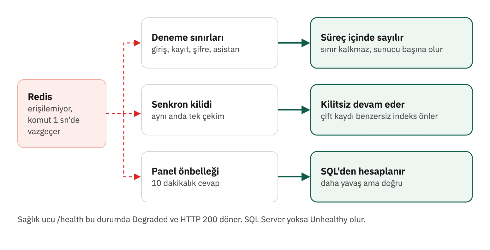

# Redis düşerse Kasa'da ne oluyor?



Kasa'nın bazı testlerinde Redis adresini `localhost:6390` yapıyorum. O portta dinleyen bir şey yok. Sonra ayrı testlerde giriş
yapıyorum, paneli açıyorum, aynı banka bağlantısı için altı senkronu aynı anda başlatıyorum. Hepsi çalışıyor.

Redis'i projede hızlandırıcı olarak kullandım ve doğruluğu ona bağlamadım. "Redis düşerse ne olur?" sorusuna tek bir cevap
yazmak da yetmedi, çünkü her kullanımda kaybedilen şey farklı. Ortak kısım bağlantı ayarı. Uygulama açılırken Redis'i beklemiyor
(`AbortOnConnectFail = false`), komutlar 1 saniyede vazgeçiyor. Hatayı yakalayan her kod kendi devam yolunu seçiyor.

## Deneme sınırları

IP başına dakikada 10 giriş denemesi var. Sayaç Redis'te, böylece birden çok API örneği aynı sayıyı görüyor. Aynı sınırlayıcı
kayıt kodu denemelerini, şifre değiştirirken girilen mevcut şifreyi ve asistanın kullanıcı başına saatte 30 soru hakkını da
sayıyor.

İlk sürümde Redis yoksa sınırı atlıyordum. Giriş için bu kabul edilebilirdi, çünkü 5 hatalı denemede hesap 15 dakika kilitleniyor
ve bu kayıt SQL Server'da duruyor. Ama hesap kilidi öteki üç sınırı kapsamıyordu. Şimdi Redis'e ulaşılamazsa aynı sınırı .NET'in
`PartitionedRateLimiter` sınıfıyla o API sürecinde sayıyorum. `With_Redis_down_signing_in_still_works` testi girişin çalıştığını,
`With_Redis_down_the_limit_is_still_counted` testi sınırı aşan denemenin 429 aldığını doğruluyor.

## Senkron kilidi

Test bankalarından hareket çeken senkron, aynı bağlantıda iki kez çalışmasın diye 5 dakikalık bir kilit alıyor:

```csharp
var token = Guid.NewGuid().ToString("N");
try
{
    return await Db.StringSetAsync(key, token, expiry, When.NotExists) ? new Lock(Db, log, key, token) : null;
}
catch (Exception ex) when (IsUnavailable(ex))
{
    log.LogWarning("Redis is not reachable; carrying on without the lock {Key}: {Error}", key, ex.Message);
    return new Lock(null, log, key, token);
}
```

Redis'e ulaşılamazsa içi boş bir kilit dönüyor. Çağıran kod farkı görmüyor ve senkrona devam ediyor. Bu güvenli, çünkü çift
kaydı `(BankAccountId, BankReference)` benzersiz indeksi engelliyor. Kilidin görevi boşa iş yapılmasını önlemek.
`With_Redis_down_concurrent_syncs_still_store_each_movement_once` testi altı senkronu kilitsiz yarıştırıyor. Üç yeni hareketin
her biri bir kez yazılıyor ve tekrar eden kayıt çıkmıyor.

## Panel önbelleği

500.000 harekette panel önbelleksiz 324,6 ms, önbellekten 2,9 ms sürüyor. Önbelleği geçersiz kılmak için anahtarı silmiyorum.
Her şirketin bir sürüm sayacı var ve önbellek anahtarı bu sürümü içeriyor. Senkron ya da eşleşme sayacı artırıyor, eski
anahtar 10 dakikada kendiliğinden gidiyor.

Sayaç ilk sürümde Redis'teydi. Bu yazıyı hazırlarken bir açık fark ettim: Redis kısa süre koparsa sayaç artmıyor, Redis verisini
koruyarak dönünce eski cevap 10 dakikaya kadar okunabiliyordu. Sayacı SQL Server'a taşıdım. Bedeli, panel isteği başına birincil
anahtardan tek okuma. `A_change_made_while_Redis_is_away_still_retires_the_cached_dashboard` testi bu durumu deniyor.

Redis yoksa panel her istekte veritabanından hesaplanıyor. Burada kaybettiğim şey hız.
`With_Redis_down_the_dashboard_is_computed_every_time` testi cevapta `X-Cache: miss` başlığını bekliyor.

## Degraded ve unhealthy

`/health` her bağımlılığı ayrı bildiriyor. SQL Server olmadan API çalışamaz, bu durumda sonuç `Unhealthy`. Redis, MongoDB ya da
RabbitMQ kapalıysa sonuç `Degraded` ve cevap 200 kalıyor, çünkü üçünün de tanımlı bir devam yolu var:

```csharp
catch (Exception ex) when (KasaRedis.IsUnavailable(ex))
{
    return HealthCheckResult.Degraded("Redis'e ulaşılamıyor: önbelleksiz ve kilitsiz çalışılıyor");
}
```

Redis kapalıyken `Unhealthy` deseydim, yük dengeleyici çalışan bir API'nin trafiğini kesebilirdi. Ayrıca `/alive` adında ikinci
bir uç var ve hiçbir bağımlılığa bakmıyor. Redis kapandı diye API'yi yeniden başlatmak bir şeyi düzeltmez.
`Api_without_Redis_and_MongoDB_is_degraded_not_down` testi 200 ve `Degraded` bekliyor. SQL Server kapalıyken dönen cevap için
ayrı bir testim yok.

## Bu seçimin bedeli

- **Sınır sunucu başına olur.** Redis kapalıyken her API örneği kendi sayacını tutuyor. Üç örnekte gerçek sınır üç katına çıkar.
- **Panelde küçük bir boşluk kalıyor.** Değişiklik kaydedildikten sonra, sayaç artmadan süreç düşerse önbellek en çok 10 dakika
  eski kalabilir.
- **Kilit erken silinebilir.** Redis `volatile-lru` ile çalışıyor. Bu politika bellek dolunca süresi olan anahtarları siler ve
  kilidin de süresi var. Kilit erken giderse ikinci bir senkron başlayabilir. Çift kaydı yine indeks engeller.
- **Her çağrı gecikebilir.** Redis kapalıyken bir komut 1 saniyeye kadar bekleyebilir. Bu gecikmeyi ölçmedim.
- **Kimse uyarılmıyor.** `Degraded` durumu panelde görünüyor, ama bunun için bir uyarı kuralı kurmadım.

Kodun tamamı, karar notları ve testler GitHub'da: [github.com/surakaraali/kasa](https://github.com/surakaraali/kasa)
