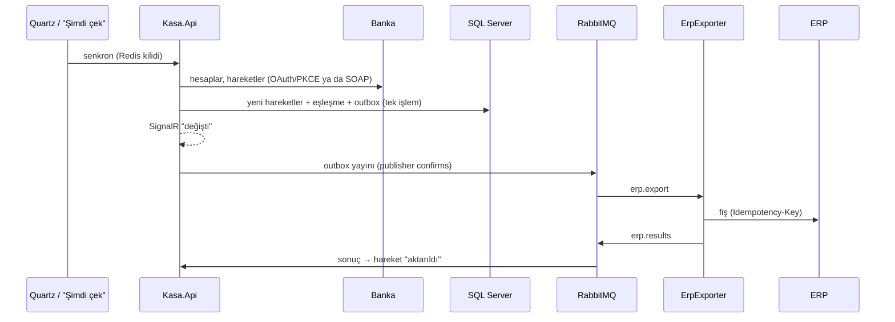

# Teknik sunum taslağı (15 dakika + soru)

Hedef dinleyici: ekibin teknik lideri ve geliştiriciler. Her slaytta tek fikir; ayrıntı soru gelirse.

## 1. Problem (1 dk)
Bir şirketin parası birkaç bankada. Muhasebeci her sabah ekstreleri indirip hangi paranın hangi müşteriden geldiğini bulup
ERP'ye fiş giriyor. Kasa bunu otomatik yapıyor ve şüphede kişiye bırakıyor.

## 2. Mimari (2 dk)
README'deki diyagram. Modüler monolit + tek mikroservis (ERP aktarımı). Neden: ERP yavaş ve kapanabiliyor, ana uygulama onu
beklememeli; geri kalanı için ayrı servis bedeli faydasından büyük (karar 0001).

## 3. Bir hareketin yolu (3 dk)

Vurgular: çift kaydı indeks engelliyor, kilit değil; eşleşme ile mesaj aynı işlemde; ERP'ye "en az bir kez" ama tek fiş.

## 4. Hata olunca (3 dk)
Hata senaryoları tablosundan beş satır: banka kapalı, bozuk tutar, ERP fişi yazıp cevap vermiyor, Redis kapalı, RabbitMQ kapalı.
Her birinin testi var. Canlı: ERP'yi kapat, Redis'i kapat.

## 5. Ölçümler (2 dk)

| | Süre |
|---|---|
| Hareketler, ilk sayfa | 4,9 ms |
| 250 bininci satırdan sonraki sayfa (keyset) | 6,1 ms |
| Aynı sayfa, yalnız SQL: OFFSET / keyset | 55 ms / 1,8 ms |
| Panel: önbelleksiz / önbellekten | 253 ms / 1,2 ms |

500 bin hareket, yerel makine, ortanca.

## 6. Güvenlik (2 dk)
Şirket izolasyonu iki katmanlı (sorgu filtresi + yazma koruması). Yenileme anahtarı rotasyonu ve çalınma tespiti. Açık
bankacılıkta state + PKCE + tarayıcıya bağlı çerez. Asistan sadece okuyor, şirket token'dan, banka açıklamaları veri.
Bilinen eksikler listesi (guvenlik.md): eksikleri bilmek de işin parçası.

## 7. Kararlar (1 dk)
14 karar notu; her birinde seçenekler ve bedel. Örnek: Serilog yerine OpenTelemetry, çünkü sorun süreçler arasındaydı.

## 8. Nasıl çalıştım (1 dk)
Plan ve hata senaryoları önce; her sprint bir kilometre taşı, kartlar commit'lerle kapanıyor; gerçek altyapıya karşı 77 test;
yapay zekâ ile birlikte geliştirildi, kararlar ve doğrulama bende (ai-assisted-development.md).

## Olası sorular
[sorular.md](sorular.md) içinde 70 soru ve ipucu, sprint sprint.
